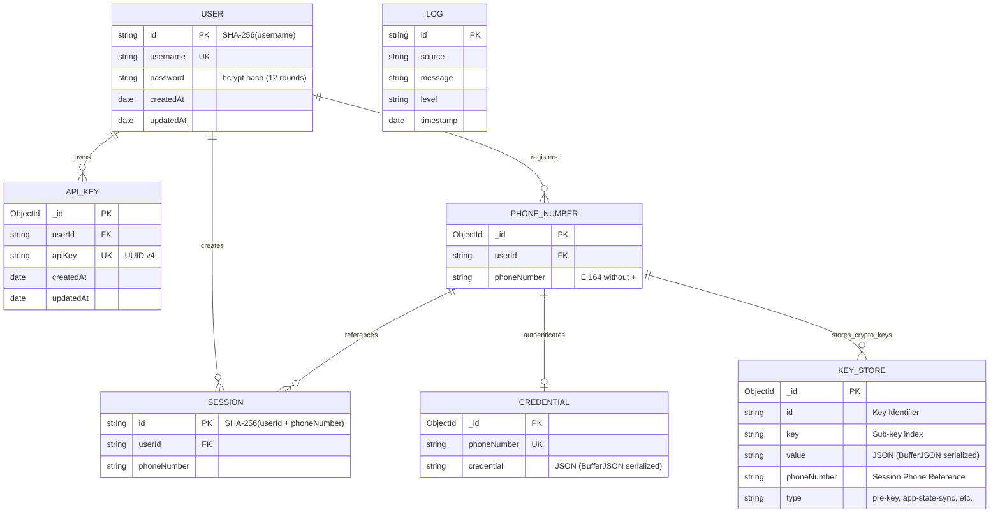

# WhatsApp Server Data Models & Persistence Architecture

This document details the database schema definitions, object relationships, binary serialization strategies, and in-memory data structures utilized in the WhatsApp Server.

---

## 1. Entity-Relationship (ER) Diagram



---

## 2. MongoDB Collections & Mongoose Schemas

All schemas are declared in `src/data/db.ts` using Mongoose 9.

### 2.1 `User`
Stores administrative user accounts with salted password hashes.
- **Collection**: `users`
- **Schema**:
  | Field | Type | Required | Unique | Description |
  |---|---|---|---|---|
  | `_id` | `String` | Yes | Yes (PK) | Deterministic SHA-256 hash of the `username`. |
  | `username` | `String` | Yes | Yes | Login username. |
  | `password` | `String` | Yes | No | Password hash generated via `bcrypt.hash(password, 12)`. |
  | `createdAt` | `Date` | Auto | No | Mongoose timestamp. |
  | `updatedAt` | `Date` | Auto | No | Mongoose timestamp. |

### 2.2 `ApiKey`
Stores API keys allocated to users for programmatic endpoint access.
- **Collection**: `apikeys`
- **Schema**:
  | Field | Type | Required | Unique | Description |
  |---|---|---|---|---|
  | `_id` | `ObjectId` | Auto | Yes (PK) | Auto-generated MongoDB ObjectId. |
  | `userId` | `String` | Yes | No | Reference to `User._id`. |
  | `apiKey` | `String` | Yes | No | UUID v4 token. |
  | `createdAt` | `Date` | Auto | No | Creation timestamp. |
  | `updatedAt` | `Date` | Auto | No | Update timestamp. |

### 2.3 `PhoneNumber`
Associates phone numbers to user accounts.
- **Collection**: `phonenumbers`
- **Schema**:
  | Field | Type | Required | Unique | Description |
  |---|---|---|---|---|
  | `_id` | `ObjectId` | Auto | Yes (PK) | Auto-generated MongoDB ObjectId. |
  | `userId` | `String` | Yes | No | Reference to `User._id`. |
  | `phoneNumber` | `String` | Yes | No | Normalized phone number string (e.g. `2348012345678`). |

### 2.4 `Session`
Represents an initialized WhatsApp connection session.
- **Collection**: `sessions`
- **Schema**:
  | Field | Type | Required | Unique | Description |
  |---|---|---|---|---|
  | `_id` | `String` | Yes | Yes (PK) | Deterministic SHA-256 hash of `userId + phoneNumber`. Aliased to `id`. |
  | `userId` | `String` | Yes | No | Reference to `User._id`. |
  | `phoneNumber` | `String` | Yes | No | Phone number associated with this session. |

### 2.5 `Credential`
Stores Baileys master authentication state and keys (`AuthenticationCreds`).
- **Collection**: `credentials`
- **Schema**:
  | Field | Type | Required | Unique | Description |
  |---|---|---|---|---|
  | `_id` | `ObjectId` | Auto | Yes (PK) | Auto-generated MongoDB ObjectId. |
  | `phoneNumber` | `String` | Yes | Yes | Phone number associated with this auth state. |
  | `credential` | `String` | Yes | No | JSON-stringified `AuthenticationCreds` serialized using `BufferJSON.replacer`. |

### 2.6 `KeyStore`
Stores Signal Protocol cryptographic keys (Pre-keys, Signed Pre-keys, Identity keys, App state sync keys, Sender keys).
- **Collection**: `keystores`
- **Schema**:
  | Field | Type | Required | Unique | Description |
  |---|---|---|---|---|
  | `_id` | `ObjectId` | Auto | Yes (PK) | Auto-generated MongoDB ObjectId. |
  | `id` | `String` | Yes | No | Composite key ID (e.g., `pre-key-1`, `session-1234`). |
  | `key` | `String` | Yes | No | Key identifier or sub-type. |
  | `value` | `String` | Yes | No | Serialized key payload (JSON with `BufferJSON.replacer`). |
  | `phoneNumber` | `String` | Yes | No | Phone number to which this cryptographic key belongs. |
  | `type` | `String` | Yes | No | Key category (`pre-key`, `session`, `sender-key`, etc.). |

### 2.7 `Log`
Batched application and HTTP access log entries.
- **Collection**: `logs`
- **Schema**:
  | Field | Type | Required | Unique | Description |
  |---|---|---|---|---|
  | `_id` | `ObjectId` | Auto | Yes (PK) | Auto-generated MongoDB ObjectId. |
  | `id` | `String` | Yes | Yes | UUID v4 for the log event. |
  | `source` | `String` | Yes | No | Log emitter tag (e.g. `HTTP_SERVER`, `WHATSAPP_MANAGER`). |
  | `message` | `String` | Yes | No | Log payload message. |
  | `level` | `String` | Yes | No | Log severity: `INFO`, `DEBUG`, `ERROR`, or `WARN`. |
  | `timestamp` | `Date` | Yes | No | UTC timestamp of the log event. |

---

## 3. Baileys NoSQL Auth Store Integration (`useNoSQLAuthState`)

Baileys requires persistent storage for cryptographic state across socket disconnects. The server implements a custom `AuthenticationState` adapter (`src/lib/auth.ts`) backed by MongoDB.

### 3.1 Binary Buffer Serialization
Signal keys contain binary buffers (`Uint8Array` / Node `Buffer`). These cannot be stored in standard JSON without losing type fidelity. The store uses Baileys' `BufferJSON`:
```typescript
import { BufferJSON, initAuthCreds } from "baileys";

// Serialization before MongoDB write:
const serialized = JSON.stringify(creds, BufferJSON.replacer);

// Deserialization on read:
const parsed = JSON.parse(doc.credential, BufferJSON.reviver);
```

### 3.2 Bulk Key Transactions
During connection synchronization, Baileys batches multiple key updates into a single transaction:
```typescript
keys: {
  get: async (type, ids) => {
    // Queries KeyStore by phoneNumber, type, and id in $in list
    // Parses and returns key-value mapping
  },
  set: async (data) => {
    // Iterates through categories and performs bulk upserts or deletions:
    // - If value is defined -> upsert KeyStore record
    // - If value is null -> delete KeyStore record
  }
}
```

---

## 4. In-Memory & Ephemeral Data Structures

### 4.1 `WhatsappManager` Singleton (`src/lib/whatsapp-manager.ts`)
- **`sockets: Map<string, WhatsappService>`**:
  - Key: `sessionId`
  - Value: Active `WhatsappService` instance encapsulating the Baileys WebSocket.
- **`isConnecting: Map<string, Promise<void>>`**:
  - Key: `sessionId`
  - Value: In-flight connection promise acting as a mutex lock.

### 4.2 `Logger` Queue (`src/lib/logger.ts`)
- **`logBuffer: LogRecord[]`**:
  - Buffer array collecting stdout logs in memory.
  - Automatically flushed in bulk to the `Log` MongoDB collection when reaching **50 records** or upon process termination signals (`handleShutdown`).

### 4.3 Disk Cache Snapshot (`data/sessions.json`)
Created during graceful shutdown (`SIGTERM`/`SIGINT`) to record active session IDs:
```json
[
  "d41d8cd98f00b204e9800998ecf8427e",
  "a8b9c0d1e2f3a4b5c6d7e8f9a0b1c2d3"
]
```
Read on server boot by `handleStartup()` to automatically re-connect all previous active sessions, and unlinked upon completion.
