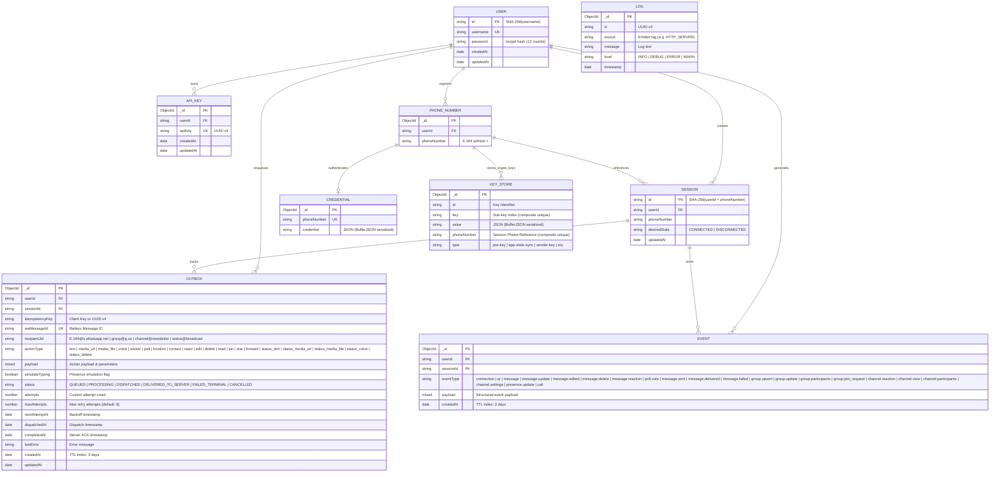

# WhatsApp Server Data Models & Persistence Architecture

This document details the database schema definitions, object relationships, binary serialization strategies, indexes, and in-memory data structures utilized in the WhatsApp Server.

---

## 1. Entity-Relationship (ER) Diagram



---

## 2. MongoDB Collections & Mongoose Schemas

All schemas are declared in `src/data/db.ts` using Mongoose 9.

### 2.1 `User`
Stores administrative user accounts with salted password hashes.
- **Collection**: `users`
- **Schema**:
  | Field | Type | Required | Unique | Description |
  |---|---|---|---|---|
  | `_id` | `String` | Yes | Yes (PK) | Deterministic SHA-256 hash of the `username`. |
  | `username` | `String` | Yes | Yes | Login username. |
  | `password` | `String` | Yes | No | Password hash generated via `bcrypt.hash(password, 12)`. |
  | `createdAt` | `Date` | Auto | No | Mongoose creation timestamp. |
  | `updatedAt` | `Date` | Auto | No | Mongoose update timestamp. |
- **Indexes**:
  - `{ username: 1 }` (unique)

---

### 2.2 `ApiKey`
Stores API keys allocated to users for programmatic endpoint access.
- **Collection**: `apikeys`
- **Schema**:
  | Field | Type | Required | Unique | Description |
  |---|---|---|---|---|
  | `_id` | `ObjectId` | Auto | Yes (PK) | Auto-generated MongoDB ObjectId. |
  | `userId` | `String` | Yes | No | Reference to `User._id`. |
  | `apiKey` | `String` | Yes | Yes | UUID v4 token. |
  | `createdAt` | `Date` | Auto | No | Creation timestamp. |
  | `updatedAt` | `Date` | Auto | No | Update timestamp. |
- **Indexes**:
  - `{ apiKey: 1 }` (unique index for $\mathcal{O}(\log M)$ authentication lookups, paired with a 60s in-memory TTL cache in `src/data/models/api-keys.ts`)
  - `{ userId: 1 }` (index for user-scoped API key queries)

---

### 2.3 `PhoneNumber`
Associates phone numbers to user accounts.
- **Collection**: `phonenumbers`
- **Schema**:
  | Field | Type | Required | Unique | Description |
  |---|---|---|---|---|
  | `_id` | `ObjectId` | Auto | Yes (PK) | Auto-generated MongoDB ObjectId. |
  | `userId` | `String` | Yes | No | Reference to `User._id`. |
  | `phoneNumber` | `String` | Yes | No | Normalized phone number string (e.g. `2348012345678`). |

---

### 2.4 `Session`
Represents an initialized WhatsApp connection session and its persistent operational state.
- **Collection**: `sessions`
- **Schema**:
  | Field | Type | Required | Default | Description |
  |---|---|---|---|---|
  | `id` | `String` | Yes | — | Deterministic SHA-256 hash of `userId + phoneNumber`. |
  | `userId` | `String` | Yes | — | Reference to `User._id`. |
  | `phoneNumber` | `String` | Yes | — | Phone number associated with this session. |
  | `desiredState` | `String` | Yes | `"DISCONNECTED"` | Target connection state: `"CONNECTED"` or `"DISCONNECTED"`. Enables cold-start recovery across process restarts and `SIGKILL` / OOM crashes. |
  | `updatedAt` | `Date` | Auto | `Date.now` | Last state update timestamp. |
- **Indexes**:
  - `{ id: 1 }` (unique)
  - `{ desiredState: 1 }` (used on startup to recover active sessions)

---

### 2.5 `Outbox`
Represents transactional outbound messages and actions queued for delivery via the Actor model. Implements two-stage delivery tracking, anti-ban throttling, and over-the-air deduplication.
- **Collection**: `outboxes`
- **Schema**:
  | Field | Type | Required | Default | Description |
  |---|---|---|---|---|
  | `userId` | `String` | Yes | — | Reference to `User._id`. |
  | `sessionId` | `String` | Yes | — | Reference to `Session.id`. |
  | `idempotencyKey` | `String` | Yes | — | Client-supplied key or auto-generated UUID v4 preventing duplicate dispatches. |
  | `waMessageId` | `String` | Yes | — | Deterministic Baileys message ID (`generateMessageIDV2()`). Reused during retransmissions. |
  | `recipientJid` | `String` | Yes | — | Normalized destination JID (`<phone>@s.whatsapp.net`, `<group>@g.us`, `<channel>@newsletter`, or `status@broadcast`). |
  | `actionType` | `String` | Yes | — | Operation type (all 20 actions): `"text"`, `"media_url"`, `"media_file"`, `"voice"`, `"sticker"`, `"poll"`, `"location"`, `"contact"`, `"react"`, `"edit"`, `"delete"`, `"read"`, `"pin"`, `"star"`, `"forward"`, `"status_text"`, `"status_media_url"`, `"status_media_file"`, `"status_voice"`, or `"status_delete"`. |
  | `payload` | `Mixed` | Yes | — | Action-specific parameters: text messages, media URLs, staged file paths, MIME types, rich cards (`poll`, `location`, `contacts`), quotes (`quoted`), user mentions (`mentions`), mutations (`messageKey`, `emoji`, `pin`, `star`, `forward`), status options (`statusOptions`), and serialized sent message object (`sentMessage`). |
  | `simulateTyping` | `Boolean` | No | `false` | When true, emits typing presence before message dispatch. |
  | `status` | `String` | Yes | `"QUEUED"` | Lifecycle state: `"QUEUED"`, `"PROCESSING"`, `"DISPATCHED"`, `"DELIVERED_TO_SERVER"`, `"FAILED_TERMINAL"`, `"CANCELLED"`. |
  | `attempts` | `Number` | Yes | `0` | Number of dispatch attempts executed. |
  | `maxAttempts` | `Number` | Yes | `6` | Maximum dispatch attempts before terminal failure (configurable via `OUTBOX_MAX_ATTEMPTS`). |
  | `nextAttemptAt` | `Date` | Yes | `Date.now` | Earliest time for next dispatch attempt (supports exponential backoff). |
  | `dispatchedAt` | `Date` | No | `null` | Timestamp when the message was sent to the Baileys socket. |
  | `completedAt` | `Date` | No | `null` | Timestamp when WhatsApp emitted `SERVER_ACK` or terminal failure occurred. |
  | `lastError` | `String` | No | `null` | Last error message encountered during execution. |
  | `createdAt` | `Date` | Auto | `Date.now` | Creation timestamp (governed by 3-day TTL index). |
  | `updatedAt` | `Date` | Auto | `Date.now` | Last update timestamp. |
- **Indexes**:
  - `{ sessionId: 1, idempotencyKey: 1 }` (unique compound index enforcing strict per-session idempotency)
  - `{ sessionId: 1, recipientJid: 1, status: 1, nextAttemptAt: 1, _id: 1 }` (compound index for direct per-JID mailbox claim by `ChatActor`)
  - `{ sessionId: 1, status: 1, nextAttemptAt: 1, _id: 1 }` (compound index for session-wide queued job discovery on reconnect)
  - `{ status: 1, dispatchedAt: 1 }` (compound index for background sweeper `SERVER_ACK` timeout recovery)
  - `{ status: 1, nextAttemptAt: 1 }` (compound index for background sweeper queued job discovery)
  - `{ sessionId: 1, waMessageId: 1 }` (index for rapid two-stage `SERVER_ACK` lookups)
  - `{ userId: 1, _id: 1 }` (index for user-scoped outbox queries)
  - `{ createdAt: 1 }` (TTL index with `expireAfterSeconds: 259200` — 3 days automatic document expiration)

---

### 2.6 `Event`
Stores time-series events emitted by the WhatsApp Multi-Device connection and outbox lifecycle, consumed via cursor-based SSE/polling (`GET /api/v1/events`).
- **Collection**: `events`
- **Schema**:
  | Field | Type | Required | Default | Description |
  |---|---|---|---|---|
  | `userId` | `String` | Yes | — | Reference to `User._id`. |
  | `sessionId` | `String` | Yes | — | Reference to `Session.id`. |
  | `eventType` | `String` | Yes | — | Event classification: Core/Outbox (`"connection"`, `"qr"`, `"message"`, `"message.update"`, `"message.edited"`, `"message.delete"`, `"message.reaction"`, `"poll.vote"`, `"message.sent"`, `"message.delivered"`, `"message.failed"`), Groups (`"group.upsert"`, `"group.update"`, `"group.participants"`, `"group.join_request"`), Channels (`"channel.reaction"`, `"channel.view"`, `"channel.participants"`, `"channel.settings"`), and Presence/Calls (`"presence.update"`, `"call"`). |
  | `payload` | `Mixed` | Yes | — | JSON event payload. |
  | `createdAt` | `Date` | Auto | `Date.now` | Event timestamp (governed by 3-day TTL index). |
- **Indexes**:
  - `{ userId: 1, _id: 1 }` (user-scoped cursor pagination)
  - `{ userId: 1, sessionId: 1, _id: 1 }` (session-scoped cursor pagination)
  - `{ userId: 1, sessionId: 1, "payload.key.id": 1 }` (rapid $\mathcal{O}(\log N)$ historical message lookup by WhatsApp message ID for `getMessage` socket hook, poll vote decryption, quotes, and forwarding)
  - `{ createdAt: 1 }` (TTL index with `expireAfterSeconds: 259200` — 3 days automatic expiration)

---

### 2.7 `Credential`
Stores Baileys master authentication state and cryptographic registration keys (`AuthenticationCreds`).
- **Collection**: `credentials`
- **Schema**:
  | Field | Type | Required | Unique | Description |
  |---|---|---|---|---|
  | `_id` | `ObjectId` | Auto | Yes (PK) | Auto-generated MongoDB ObjectId. |
  | `phoneNumber` | `String` | Yes | Yes | Phone number associated with this auth state. |
  | `credential` | `String` | Yes | No | JSON-stringified `AuthenticationCreds` serialized using `BufferJSON.replacer`. |
- **Indexes**:
  - `{ phoneNumber: 1 }` (unique)

---

### 2.8 `KeyStore`
Stores Signal Protocol cryptographic keys (Pre-keys, Signed Pre-keys, Identity keys, App state sync keys, Sender keys).
- **Collection**: `keystores`
- **Schema**:
  | Field | Type | Required | Unique | Description |
  |---|---|---|---|---|
  | `_id` | `ObjectId` | Auto | Yes (PK) | Auto-generated MongoDB ObjectId. |
  | `id` | `String` | Yes | No | Key identifier (e.g. `pre-key-1`, `session-1234`). |
  | `key` | `String` | Yes | No | Key identifier or sub-type (e.g. `pre-key-1`). |
  | `value` | `String` | Yes | No | Serialized key payload (JSON with `BufferJSON.replacer`). |
  | `phoneNumber` | `String` | Yes | No | Phone number to which this cryptographic key belongs. |
  | `type` | `String` | Yes | No | Key category (`pre-key`, `session`, `sender-key`, `app-state-sync-key`, etc.). |
- **Indexes**:
  - `{ phoneNumber: 1, key: 1 }` (unique compound index preventing key collisions)

---

### 2.9 `Log`
Batched application and HTTP access log entries.
- **Collection**: `logs`
- **Schema**:
  | Field | Type | Required | Unique | Description |
  |---|---|---|---|---|
  | `_id` | `ObjectId` | Auto | Yes (PK) | Auto-generated MongoDB ObjectId. |
  | `id` | `String` | Yes | Yes | UUID v4 for the log event. |
  | `source` | `String` | Yes | No | Log emitter tag (e.g. `HTTP_SERVER`, `OutboxEngine`, `WhatsappManager`). |
  | `message` | `String` | Yes | No | Log payload message. |
  | `level` | `String` | Yes | No | Log severity: `INFO`, `DEBUG`, `ERROR`, or `WARN`. |
  | `timestamp` | `Date` | Yes | No | UTC timestamp of the log event. |

---

## 3. Baileys NoSQL Auth Store & Key Store Mutex

Baileys requires persistent storage for cryptographic state across socket disconnects. The server implements a custom `AuthenticationState` adapter (`src/lib/auth.ts`) backed by MongoDB.

### 3.1 Binary Buffer Serialization
Signal keys contain binary buffers (`Uint8Array` / Node `Buffer`). These cannot be stored in standard JSON without losing type fidelity. The store uses Baileys' `BufferJSON`:
```typescript
import { BufferJSON, initAuthCreds } from "baileys";

// Serialization before MongoDB write:
const serialized = JSON.stringify(creds, BufferJSON.replacer);

// Deserialization on read:
const parsed = JSON.parse(doc.credential, BufferJSON.reviver);
```

### 3.2 Per-Phone Async Key Mutex (`withKeyLock`)
To prevent concurrent read-modify-write collisions and Signal Double-Ratchet key desynchronization during simultaneous connection events or stanzas, all credentials and key store reads/writes are protected by an in-memory per-phone async mutex:

```typescript
const keyLocks = new Map<string, Promise<unknown>>();

async function withKeyLock<T>(phoneNumber: string, fn: () => Promise<T>): Promise<T> {
    const current = keyLocks.get(phoneNumber) ?? Promise.resolve();
    let resolveLock!: () => void;
    const next = new Promise<void>((resolve) => { resolveLock = resolve; });
    keyLocks.set(phoneNumber, next);

    try {
        await current.catch(() => {});
        return await fn();
    } finally {
        resolveLock();
        if (keyLocks.get(phoneNumber) === next) {
            keyLocks.delete(phoneNumber);
        }
    }
}
```

### 3.3 Atomic Bulk Transactions (`KeyStore.bulkWrite`)
During session synchronization, Baileys emits multiple key updates and deletions simultaneously. `auth.ts` combines these into a single atomic MongoDB `bulkWrite` operation:
- Key upserts are compiled into `{ updateOne: { filter: { phoneNumber, key }, update: { $set: entry }, upsert: true } }`.
- Key deletions are compiled into `{ deleteMany: { filter: { phoneNumber, key: { $in: toDeleteKeys } } } }`.
This guarantees all ratchet updates succeed or fail atomically without exposing partial key sets to concurrent callers.

---

## 4. In-Memory & Ephemeral Data Structures

### 4.1 `OutboxEngine` (`src/lib/outbox.ts`)
The `OutboxEngine` manages mailbox execution, anti-ban rate limiting, and two-stage delivery verification:
- **`runningActors: Set<string>`**:
  - Contains keys in the format `${sessionId}:${recipientJid}`.
  - Tracks mailboxes currently being drained by a `ChatActor` instance. Ensures strict `concurrency: 1` per conversation thread.
- **`actorPending: Map<string, boolean>`**:
  - Key: `${sessionId}:${recipientJid}`.
  - Value: Flag indicating whether additional messages were queued while the `ChatActor` was busy. When the active loop finishes, it checks this map and immediately drains subsequent messages without race conditions.
- **`earlyAckSet: Set<string>`**:
  - Set of Baileys `waMessageId` strings representing receipt acknowledgements (`SERVER_ACK`) that arrived from the WhatsApp network before the local database write transitioning the job to `DISPATCHED` was completed.
  - Prevents race conditions by automatically clearing the ID after 10 seconds and directly marking the outbox document `DELIVERED_TO_SERVER`.
- **`ackTimeouts: Map<string, NodeJS.Timeout>`**:
  - Key: `waMessageId`.
  - Value: Active 20-second timer handle (`ACK_TIMEOUT_MS`).
  - Cleared when an ACK receipt is received or when the socket disconnects. If the timer fires, the job transitions back to `QUEUED` for replay or to `FAILED_TERMINAL` if `attempts >= maxAttempts`.
- **`sweepInterval: NodeJS.Timeout | null`**:
  - Background interval timer (default 5000ms: `OUTBOX_SWEEP_INTERVAL_MS`).
  - Executes `runSweep()` to recover timed-out `DISPATCHED` jobs and notify queued jobs for active sessions.

### 4.2 `SessionRateLimiter` (`src/lib/outbox.ts`)
Controls the outbound throughput per WhatsApp session to prevent network bans:
- **`history: Map<string, number[]>`**:
  - Key: `sessionId`.
  - Value: Array of millisecond timestamps of outgoing messages dispatched within the last 60 seconds.
  - Enforces `RATE_LIMIT_PER_MIN` (default 20 requests per minute).
- **`queues: Map<string, Promise<void>>`**:
  - Key: `sessionId`.
  - Value: Serialized promise chain ensuring asynchronous callers queue up cleanly and evaluate rate limit quotas sequentially without race conditions.

### 4.3 Disk Staging Subsystem (`data/outbox-media/`)
Multipart file uploads for media messages (`/send/file`, `/send/voice`, `/send/sticker`, `/groups/:groupJid/send/file`, `/groups/:groupJid/send/voice`, `/groups/:groupJid/send/sticker`, `/channels/:channelJid/send/file`, `/status/file`, `/status/voice`) and picture updates are staged directly to the filesystem:
- **Directory**: `data/outbox-media/` (created automatically on startup).
- **Filename Formatting**: `${randomUUID()}${ext}` using Node's cryptographic `randomUUID()`.
- **Upload Limit**: Enforces a strict 25MB ceiling (`limits: { fileSize: 25 * 1024 * 1024 }`).
- **Automatic Lifecycle Cleanup**:
  - **Validation Errors**: If declarative validation fails in `validate.ts`, `unlink(req.file.path)` is invoked immediately before sending HTTP 400.
  - **Delivery Confirmation**: When `handleAck()` marks an outbox record as `DELIVERED_TO_SERVER` (or immediately upon dispatch for actions with immediate completion), the staged file is unlinked.
  - **Terminal Failures**: When a job transitions to `FAILED_TERMINAL` (e.g. invalid recipient, message not found, max attempts exceeded, or session disconnect), the file is unlinked.
  - **Duplicate Idempotency**: If a client re-submits a request with an identical `Idempotency-Key` and a new file, the old staged file is immediately unlinked.

### 4.4 In-Memory Group Metadata Cache (`groupCache` in `WhatsappService`)
To eliminate redundant WhatsApp network queries when performing group messaging, validating permissions, or expanding group-wide mentions (`@all`), each `WhatsappService` instance maintains an in-memory group metadata cache:
- **Structure**: `groupCache: Map<string, { data: GroupMetadata; expiresAt: number }>`
- **TTL**: 5 minutes (300,000ms).
- **Socket Hook**: Registered with Baileys socket options as `cachedGroupMetadata: async (jid) => { const entry = this.groupCache.get(jid); return (entry && entry.expiresAt > Date.now()) ? entry.data : undefined; }`.
- **Event-Driven Cache Coherence**:
  - Populated or updated whenever `groupMetadata()` is called or when Baileys receives a `groups.upsert` event.
  - Automatically invalidated (`groupCache.delete(jid)`) when receiving `groups.update` or `group-participants.update` socket events, ensuring stale participant lists or subject/setting updates are never retained past external changes.

### 4.5 `WhatsappManager` Singleton (`src/lib/whatsapp-manager.ts`)
- **`sockets: Map<string, WhatsappService>`**:
  - Key: `sessionId`.
  - Value: Active `WhatsappService` instance encapsulating the Baileys WebSocket and session state.
- **`isConnecting: Map<string, Promise<void>>`**:
  - Key: `sessionId`.
  - Value: In-flight connection promise acting as a concurrency mutex to prevent duplicate socket connections for the same session.

### 4.6 `Logger` Queue (`src/lib/logger.ts`)
- **`logBuffer: LogRecord[]`**:
  - Array collecting structured log events in memory.
  - Flushed in bulk to the `Log` MongoDB collection when reaching **50 records** or upon process termination signals (`handleShutdown`).

### 4.7 Legacy Disk Cache Snapshot (`data/sessions.json`)
- Retained for backward compatibility. If present during server cold start, `handleStartup()` reads active session IDs, migrates them to MongoDB `Session.desiredState = "CONNECTED"`, and unlinks the file.
