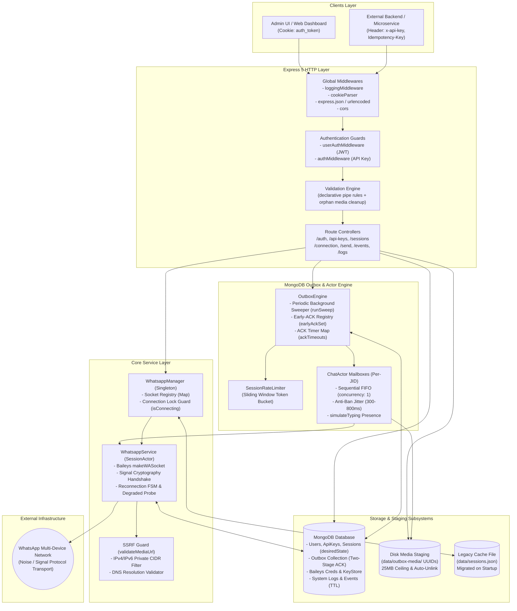
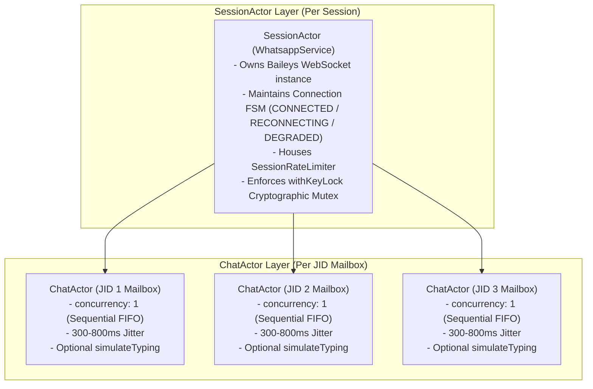
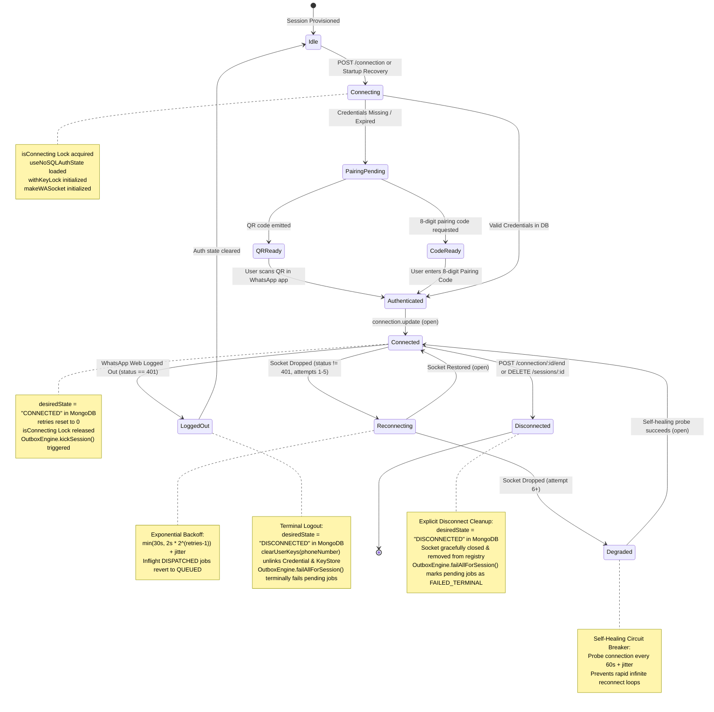
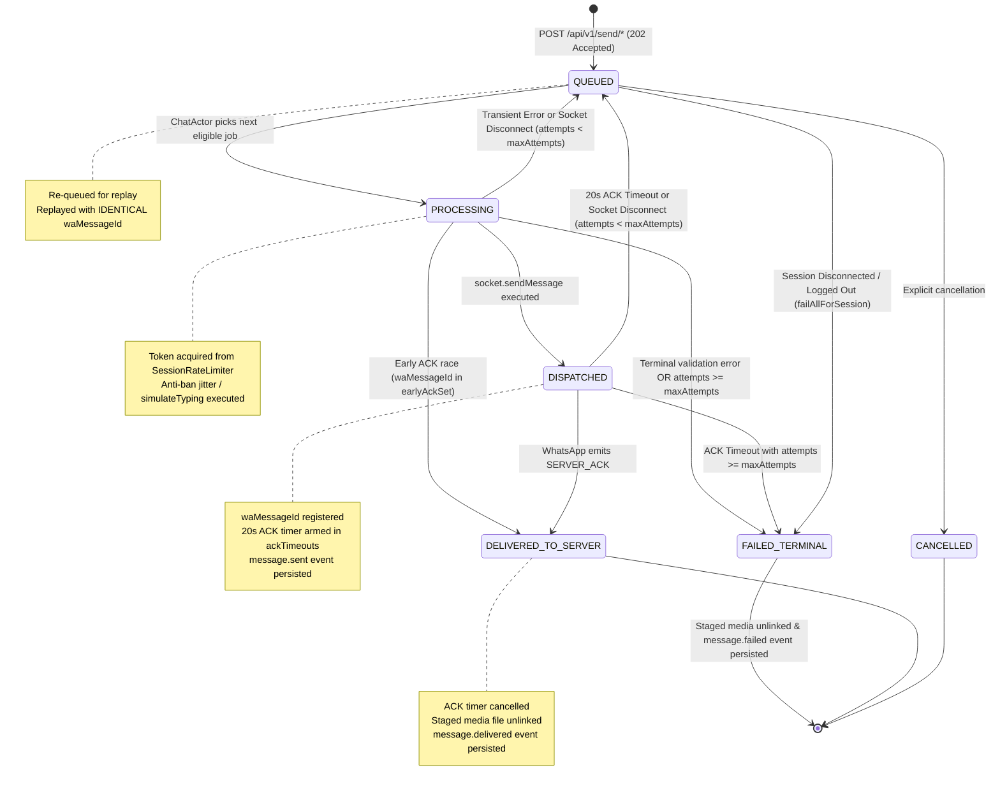
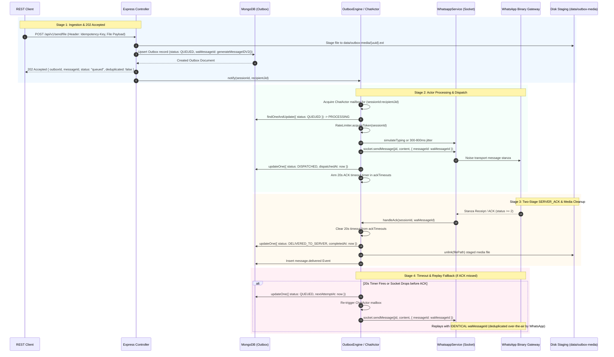
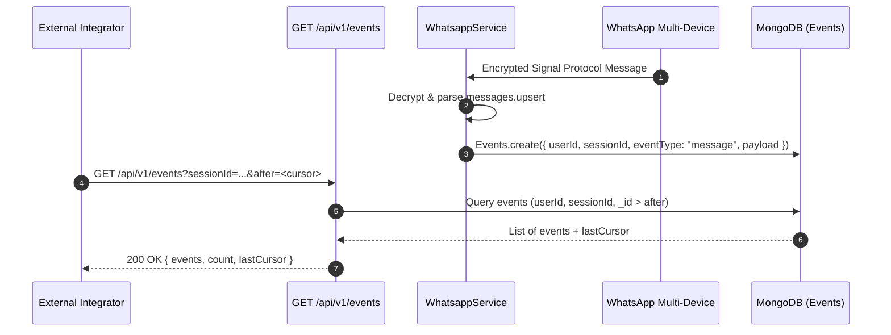

# WhatsApp Server System Architecture & Design

This document describes the architectural design, internal components, state lifecycle, concurrency model, security mechanisms, and data flows of the WhatsApp Server.

---

## 1. High-Level System Architecture

The WhatsApp Server acts as a bridge between standard HTTP/REST clients and the decentralized WhatsApp Multi-Device network (Noise / Signal Protocol). It incorporates a transactional MongoDB Outbox and an Actor-based concurrency engine to guarantee at-least-once message delivery, strict per-recipient sequential ordering, and resilience against process terminations.



---

## 2. Dual-Tier Authentication Architecture

The server decouples human administrative interactions from machine-to-machine API dispatching:

```mermaid
sequenceDiagram
    autonumber
    participant Admin as Admin / Web Client
    participant API as Express Router
    participant DB as MongoDB
    participant App as External Integrator

    rect rgb(240, 248, 255)
        Note over Admin,DB: Tier 1: User & Session Provisioning (JWT Cookie)
        Admin->>API: POST /api/auth/login { username, password }
        API->>DB: Query User & verify bcrypt hash
        DB-->>API: User verified
        API-->>Admin: Set-Cookie: auth_token=<JWT>; HttpOnly
        Admin->>API: POST /api/api-keys/generate (with auth_token)
        API->>DB: Insert new ApiKey (UUID v4)
        DB-->>API: Created
        API-->>Admin: { apiKey: "9b1deb4d-..." }
        Admin->>API: POST /api/sessions { phoneNumber }
        API->>DB: Store Session record (id: SHA256(userId + phone), desiredState: DISCONNECTED)
        API-->>Admin: { sessionId: "e3b0c44..." }
    end

    rect rgb(245, 255, 250)
        Note over App,DB: Tier 2: Programmatic WhatsApp Operations (API Key + Idempotency)
        App->>API: POST /api/v1/send/text (Header: x-api-key, Idempotency-Key)
        API->>DB: Validate x-api-key in ApiKey collection
        DB-->>API: Valid user ID
        API->>DB: Upsert Outbox record (status: QUEUED)
        API-->>App: 202 Accepted { outboxId, messageId, status: "queued", deduplicated: false }
    end
```

---

## 3. Actor Hierarchy & Anti-Ban Rate Limiting

### 3.1 Why Traditional Queues Fail in WhatsApp Multi-Device (Baileys)

Common background job patterns (e.g., global Redis/BullMQ queues or multi-threaded worker pools) fail when integrated with the WhatsApp Multi-Device protocol:

1. **Session Affinity & Socket Ownership**:
   - Baileys maintains a persistent, stateful WebSocket connection held in local process memory (`makeWASocket`).
   - If arbitrary workers dequeue jobs concurrently, they lack direct access to the active socket instance without complex inter-process RPC or sticky routing.
2. **Signal Protocol Double-Ratchet State Corruption**:
   - WhatsApp end-to-end encryption relies on the Signal Protocol's Double Ratchet algorithm. Each incoming and outgoing message advances the cryptographic ratchet keys sequentially.
   - If multiple concurrent worker threads attempt to transmit messages for the same WhatsApp session simultaneously, they read identical baseline ratchet states from the database, generate conflicting encrypted stanzas, and write back interleaved key states. This causes irreversible cryptographic key desynchronization. The recipient's phone encounters permanent decryption failures (manifested as `"Waiting for this message. This may take a while"`).
3. **Head-of-Line (HoL) Blocking**:
   - A single FIFO queue per session introduces Head-of-Line blocking: if a large video transmission or a message to a slow recipient stalls, all subsequent messages to completely unrelated contacts are blocked behind it.

### 3.2 The Actor Model Solution

The WhatsApp Server resolves these issues by adopting the **Actor Model** across two distinct layers:



- **`SessionActor` (`WhatsappService` / `WhatsappManager`)**:
  - Owns the physical WebSocket connection and the connection finite state machine.
  - Controls access to Signal keys via the `withKeyLock` asynchronous mutex, ensuring atomic cryptographic mutations.
  - Enforces a sliding-window token bucket (`SessionRateLimiter`, default 20 operations per minute per session) to prevent session-level throttling from WhatsApp servers.
- **`ChatActor` (Per-JID Mailbox)**:
  - Dynamically instantiated per `${sessionId}:${recipientJid}` tuple via `OutboxEngine.runningActors` and `actorPending`.
  - Guarantees strict sequential execution (`concurrency: 1`) for that specific recipient, eliminating race conditions while allowing independent recipients to be processed concurrently without Head-of-Line blocking.
  - Applies anti-ban pacing:
    - **Jitter**: Introduces a randomized delay of 300–800ms before message transmission.
    - **Presence Simulation**: When `simulateTyping: true` is requested, transmits an initial `sendTyping` presence stanza, waits 1000–2000ms, transmits `sendTypingPaused`, and finally dispatches the payload. This emulates natural human conversation cadence and avoids automated heuristic bans.

---

## 4. WhatsApp Multi-Device Lifecycle & Connection State Machine

Each WhatsApp connection is managed by an isolated `WhatsappService` instance encapsulating `@whiskeysockets/baileys`.

### 4.1 Connection State Machine



### 4.2 Reconnection Strategy & Self-Healing Circuit Breaker
1. **Exponential Backoff (Attempts 1–5)**:
   - When a socket drops unexpectedly with a non-401 status code, the connection transitions to `RECONNECTING`.
   - Reconnection delay scales exponentially: `min(30000ms, 2000ms * 2^(retries - 1)) + randomJitter(0-1000ms)`.
2. **Degraded State Circuit Breaker (Attempt 6+)**:
   - If the connection fails after 5 successive attempts, the state transitions to `DEGRADED`.
   - Instead of aggressive retries that trigger IP bans or CPU spikes, the system engages a low-frequency self-healing probe: attempts occur once every 60 seconds (plus 0–5000ms randomized jitter) until connectivity is re-established.
3. **Terminal Logout & Explicit Disconnect Cleanup**:
   - **401 Unauthorized (`DisconnectReason.loggedOut`)**: The session has been revoked from the WhatsApp mobile device. The server clears the session's credentials from `Credential` and `KeyStore`, sets `Session.desiredState = "DISCONNECTED"`, emits `'logged.out'`, and terminates all pending outbox jobs (`failAllForSession`).
   - **Explicit Disconnect**: When an operator issues a disconnect request, `WhatsappManager` sets `desiredState = "DISCONNECTED"`, closes the socket, and triggers `failAllForSession`, ensuring queued and in-flight outbox items transition to `FAILED_TERMINAL` rather than remaining in limbo.

### 4.3 Inflight Concurrency Guard (`isConnecting`)
To prevent duplicate socket instantiation when concurrent requests target the same session:
1. `WhatsappManager` maintains an in-memory `Map<string, Promise<void>>` (`isConnecting`).
2. Concurrent callers await the in-flight connection promise.
3. Once the socket establishes or terminates, the promise resolves and is removed from the map.

---

## 5. Outbox Message Lifecycle & Two-Stage `SERVER_ACK` Verification

The messaging pipeline uses a persistent MongoDB Outbox pattern to guarantee at-least-once delivery, full idempotency, and cryptographic verification of message transit.

### 5.1 Outbox State Machine



### 5.2 Two-Stage Delivery Sequence



### 5.3 Over-the-Air Idempotency & Replay Semantics
- **Deterministic Message IDs**: Every outbox item pre-allocates a Baileys `waMessageId` (`generateMessageIDV2()`) upon insertion into MongoDB.
- **Replay Safety**: If a message is dispatched to the network but the server socket drops or the 20-second ACK timeout expires before receiving confirmation, the message transitions back to `QUEUED`. When replayed, it transmits with the **exact same `waMessageId`**. WhatsApp edge servers recognize the duplicate message ID and suppress duplicate delivery to the recipient's handset while returning the missing server acknowledgement.
- **Early ACK Protection (`earlyAckSet`)**: In high-speed network conditions, WhatsApp's receipt ACK stanza may arrive before the local database write marking `DISPATCHED` completes. The engine buffers incoming receipt IDs in an in-memory `earlyAckSet` (retained for 10 seconds), ensuring out-of-order ACKs immediately promote the message directly to `DELIVERED_TO_SERVER`.

---

## 6. Signal Protocol Key Store Mutex & Concurrency Guard

The Signal Protocol relies on strict transactional integrity during Double-Ratchet key derivation. Simultaneous read/write access to cryptographic keys causes session desynchronization.

### 6.1 Per-Phone Async Mutex Lock (`withKeyLock`)
In `src/lib/auth.ts`, all operations against Baileys credentials and cryptographic keys are synchronized using a per-phone mutex:

```typescript
const keyLocks = new Map<string, Promise<unknown>>();

async function withKeyLock<T>(phoneNumber: string, fn: () => Promise<T>): Promise<T> {
    const current = keyLocks.get(phoneNumber) ?? Promise.resolve();
    let resolveLock!: () => void;
    const next = new Promise<void>((resolve) => { resolveLock = resolve; });
    keyLocks.set(phoneNumber, next);

    try {
        await current.catch(() => {});
        return await fn();
    } finally {
        resolveLock();
        if (keyLocks.get(phoneNumber) === next) {
            keyLocks.delete(phoneNumber);
        }
    }
}
```

### 6.2 Atomic `KeyStore.bulkWrite`
During connection synchronization, Baileys emits batch key updates. Instead of individual sequential updates that could interleave with other operations, updates are grouped into a single atomic MongoDB `bulkWrite`:
- **Upserts**: Applied via `{ updateOne: { filter: { phoneNumber, key }, update: { $set: entry }, upsert: true } }`.
- **Deletions**: Applied via `{ deleteMany: { filter: { phoneNumber, key: { $in: toDeleteKeys } } } }`.
- Guaranteed atomicity across pre-keys, sender keys, and app state sync keys prevents Double-Ratchet state corruption.

---

## 7. Real-Time Message Streaming (SSE & Events)

Incoming messages and status events received over the WhatsApp binary transport are persisted into MongoDB as structured events and retrieved by clients via cursor-based polling (`GET /api/v1/events`).



Event categories recorded in the `events` collection include:
- `message`: Incoming and outgoing chat messages.
- `message.update`: Status updates (sent, delivered, read receipts).
- `message.sent`: Dispatched to WhatsApp edge servers.
- `message.delivered`: Two-stage `SERVER_ACK` received from WhatsApp.
- `message.failed`: Terminal delivery failure with error details.
- `connection`: Status transitions (`CONNECTING`, `CONNECTED`, `RECONNECTING`, `DEGRADED`, `DISCONNECTED`).
- `qr`: Fresh QR code authentication strings.

---

## 8. Security & SSRF Protection Subsystem

When handling media uploads and remote URLs, the server implements strict defenses against Server-Side Request Forgery (SSRF), disk exhaustion, and unauthorized data leakage.

### 8.1 SSRF Defense-in-Depth Pipeline (`validateMediaUrl`)
1. **Protocol Restriction**: Restricts URLs strictly to `http:` and `https:`.
2. **DNS Resolution**: Resolves target hostnames using system DNS before executing HTTP requests.
3. **CIDR IP Blacklisting**: Evaluates resolved IP addresses against private, loopback, link-local, and reserved CIDR ranges:
   - **IPv4**: `10.0.0.0/8`, `172.16.0.0/12`, `192.168.0.0/16`, `127.0.0.0/8`, `169.254.0.0/16`, `0.0.0.0/8`, `100.64.0.0/10`, `224.0.0.0/4`, `240.0.0.0/4`.
   - **IPv6**: `::1/128`, `fc00::/7` (ULA), `fe80::/10` (Link-Local), `::ffff:0:0/96` (IPv4-Mapped), `ff00::/8` (Multicast).

### 8.2 Disk Staging & Orphan File Cleanup (`data/outbox-media/`)
1. **Multer Disk Staging**: Incoming media file uploads are written directly to disk at `data/outbox-media/` with unique UUID filenames (`${randomUUID()}${ext}`) to prevent collisions, memory exhaustion, and path traversal attacks.
2. **25MB Size Ceiling**: File uploads enforce a strict 25MB ceiling (`limits: { fileSize: 25 * 1024 * 1024 }`).
3. **Automatic Orphan Cleanup in `validate.ts`**: If an incoming multipart request fails declarative validation rules (e.g., missing required fields, invalid phone number format), the validation middleware immediately calls `unlink(req.file.path)` prior to returning HTTP 400, ensuring no stranded files accumulate on disk.
4. **Lifecycle Deletion**:
   - Staged files are unlinked upon receiving `SERVER_ACK` (`DELIVERED_TO_SERVER`).
   - Staged files are unlinked if the job exceeds `maxAttempts` or encounters a terminal error (`FAILED_TERMINAL`).
   - If an incoming request matches an existing idempotency key with a new staged file, the superseded file is immediately unlinked.

---

## 9. Crash-Proof Startup & Cold-Start Recovery

To ensure resilient operation across intentional deployments, server reboots, and abrupt OS termination (`SIGKILL` / OOM events), the server couples MongoDB state persistence with automatic recovery routines.

```mermaid
flowchart TD
    subgraph Shutdown["Graceful Shutdown (SIGINT / SIGTERM / SIGUSR2)"]
        S1["Capture OS Signal"] --> S2["outboxEngine.stop() clears sweep & timers"]
        S2 --> S3["Flush in-memory logBuffer to MongoDB"]
        S3 --> S4["whatsappService.clearAll() ends active sockets"]
        S4 --> S5["Close HTTP Listener & Exit 0"]
    end

    subgraph Startup["Cold-Start Recovery (handleStartup)"]
        U1["Server listens on PORT"] --> U2["outboxEngine.start()"]
        U2 --> U3["Reset orphaned PROCESSING jobs -> QUEUED"]
        U3 --> U4["Check for legacy data/sessions.json"]
        U4 -- Found --> U5["Migrate legacy IDs to desiredState: CONNECTED in MongoDB"]
        U5 --> U6["Unlink data/sessions.json"]
        U4 -- Not Found --> U7["Query MongoDB: Session.find({ desiredState: CONNECTED })"]
        U6 --> U7
        U7 --> U8["Trigger whatsappService.connect(sessionId) for each"]
        U8 --> U9["Trigger outboxEngine.kickSession(sessionId)"]
        U9 --> U10["Server Ready for HTTP Requests"]
    end
```



### 9.1 `Session.desiredState` vs. Legacy Disk Caching
- **The Problem with Ephemeral Disk Cache (`data/sessions.json`)**: Legacy implementations wrote active session IDs to disk only during graceful shutdown hooks (`SIGINT`, `SIGTERM`). In events such as container OOM kills, kernel panics, or sudden power termination (`SIGKILL`), shutdown handlers never execute, resulting in total loss of active session context upon restart.
- **MongoDB `Session.desiredState`**:
  - `Session` documents persist an explicit `desiredState: "CONNECTED" | "DISCONNECTED"`.
  - When a session successfully connects, `desiredState` is atomically marked `"CONNECTED"`.
  - When an explicit disconnect or 401 terminal logout occurs, `desiredState` is set to `"DISCONNECTED"`.
  - Upon startup, `handleStartup()` restores all sessions marked `"CONNECTED"`.
- **Backward Compatibility**: On startup, `handleStartup()` checks if a legacy `data/sessions.json` file is present. If found, it migrates each listed session to `desiredState: "CONNECTED"` in MongoDB and unlinks the legacy file.
- **Orphan Job Re-queuing**: `OutboxEngine.start()` automatically detects any jobs stranded in `status: "PROCESSING"` (from an ungraceful shutdown during message execution) and resets them to `"QUEUED"` with `nextAttemptAt = now`, guaranteeing no messages are permanently lost.

---

## 10. Known System Characteristics & Considerations

1. **In-Memory Session Map & Horizontal Scaling**:
   - `WhatsappManager` maintains active Baileys socket connections in process memory (`sockets: Map<string, WhatsappService>`).
   - In horizontally scaled multi-worker deployments (e.g., Kubernetes pods or PM2 cluster mode), requests targeting a specific `sessionId` must use **sticky sessions** or route to the specific worker node maintaining that session's WebSocket.
2. **Phone Number Normalization**:
   - The current validator assumes phone numbers conform to Nigerian telecom formats (`080...` -> `23480...`). International numbers outside this prefix pattern require format adjustment in `src/utils/format.ts`.
3. **Database Indexing**:
   - All critical query paths in `Session`, `Outbox`, `Credential`, `KeyStore`, and `Event` are protected by compound and unique indexes to maintain sub-millisecond query latencies under high transaction volumes.
