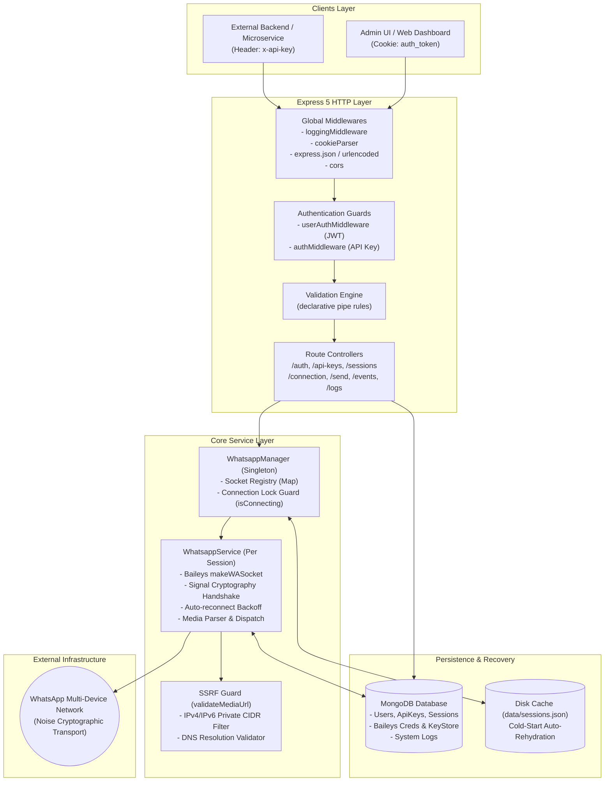
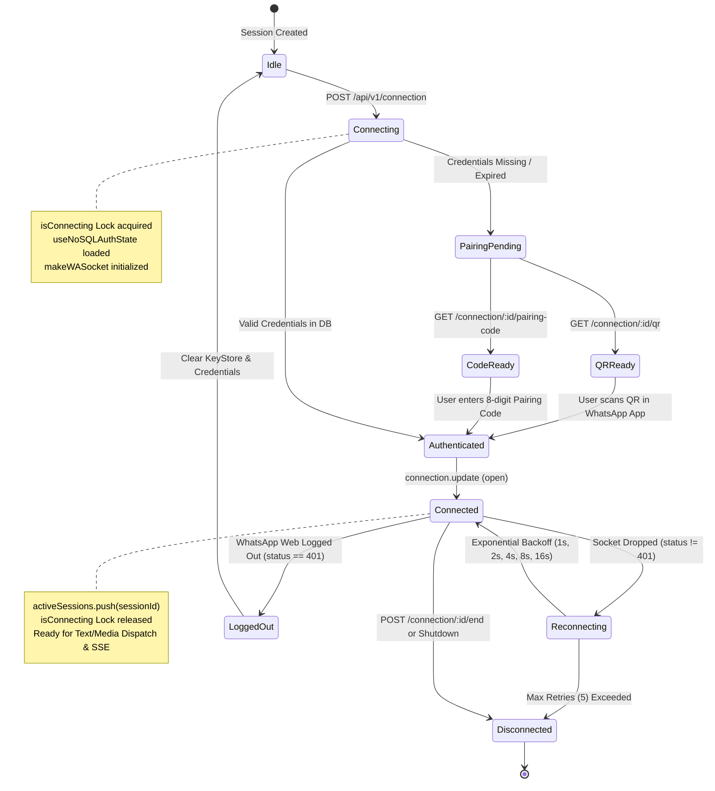
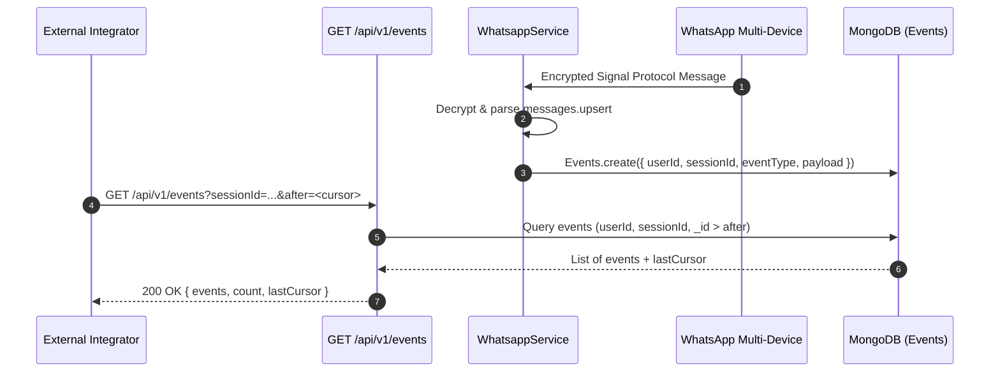

# WhatsApp Server System Architecture & Design

This document describes the architectural design, internal components, state lifecycle, security mechanisms, and data flows of the WhatsApp Server.

---

## 1. High-Level System Architecture

The WhatsApp Server acts as a bridge between standard HTTP/REST clients and the decentralized WhatsApp Multi-Device network (Noise / Signal Protocol).



---

## 2. Dual-Tier Authentication Architecture

The server decouples human administrative interactions from machine-to-machine API dispatching:

```mermaid
sequenceDiagram
    autonumber
    participant Admin as Admin / Web Client
    participant API as Express Router
    participant DB as MongoDB
    participant App as External Integrator

    rect rgb(240, 248, 255)
        Note over Admin,DB: Tier 1: User & Session Provisioning (JWT Cookie)
        Admin->>API: POST /api/auth/login { username, password }
        API->>DB: Query User & verify bcrypt hash
        DB-->>API: User verified
        API-->>Admin: Set-Cookie: auth_token=<JWT>; HttpOnly
        Admin->>API: POST /api/api-keys/generate (with auth_token)
        API->>DB: Insert new ApiKey (UUID v4)
        DB-->>API: Created
        API-->>Admin: { apiKey: "9b1deb4d-..." }
        Admin->>API: POST /api/sessions { phoneNumber }
        API->>DB: Store Session record (id: SHA256(userId + phone))
        API-->>Admin: { sessionId: "e3b0c44..." }
    end

    rect rgb(245, 255, 250)
        Note over App,DB: Tier 2: Programmatic WhatsApp Operations (API Key)
        App->>API: POST /api/v1/send/text (Header: x-api-key)
        API->>DB: Validate x-api-key in ApiKey collection
        DB-->>API: Valid user ID
        API->>API: Dispatch via WhatsappManager socket
        API-->>App: { success: true, message: "Message sent successfully" }
    end
```

---

## 3. WhatsApp Multi-Device Lifecycle & Connection State Machine

Each WhatsApp connection is managed by an isolated `WhatsappService` instance encapsulating `@whiskeysockets/baileys`.

### 3.1 Connection State Machine



### 3.2 Inflight Concurrency Guard (`isConnecting`)
To prevent race conditions when multiple API consumers simultaneously attempt to connect the same session ID, `WhatsappManager` maintains an in-memory `Map<string, Promise<void>>`:
1. The first call creates a connection promise and registers it in `isConnecting`.
2. Subsequent concurrent requests await the identical promise rather than creating duplicate Baileys socket instances.
3. Once the connection reaches `open` or fails, the promise is removed from `isConnecting`.

---

## 4. Real-Time Message Streaming (SSE)

Incoming messages received over the WhatsApp binary transport are persisted into MongoDB as structured events and retrieved by clients via cursor-based polling (`GET /api/v1/events`).



---

## 5. Security & SSRF Protection Subsystem

When media messages are sent via URLs or files, the server guards against Server-Side Request Forgery (SSRF) and malicious host resolutions via `validateMediaUrl` (`src/utils/url.ts`).

### 5.1 Defense-in-Depth Pipeline
1. **Protocol Restriction**: Restricts URLs strictly to `http:` and `https:`.
2. **DNS Resolution**: Resolves hostnames to IP addresses using system DNS resolvers.
3. **CIDR IP Blacklisting**: Evaluates resolved IPs against private, loopback, link-local, and reserved CIDR ranges:
   - **IPv4**: `10.0.0.0/8`, `172.16.0.0/12`, `192.168.0.0/16`, `127.0.0.0/8`, `169.254.0.0/16`, `0.0.0.0/8`, `100.64.0.0/10`, `224.0.0.0/4`, `240.0.0.0/4`.
   - **IPv6**: `::1/128`, `fc00::/7` (ULA), `fe80::/10` (Link-Local), `::ffff:0:0/96` (IPv4-Mapped), `ff00::/8` (Multicast).
4. **Binary Buffer Limit**: Enforces a strict 25MB ceiling on uploaded media files via Multer memory storage.

---

## 6. Graceful Shutdown & Cold-Start Recovery

To ensure zero downtime session disruption during server restarts or container re-deployments:

```mermaid
flowchart TD
    subgraph Shutdown["Graceful Shutdown (SIGINT / SIGTERM / SIGUSR2)"]
        S1["Capture OS Termination Signal"] --> S2["Collect Active Session IDs from WhatsappManager"]
        S2 --> S3["Serialize Active IDs to disk (data/sessions.json)"]
        S3 --> S4["Flush in-memory LogBuffer to MongoDB Log Collection"]
        S4 --> S5["Close HTTP Server Listener & Exit 0"]
    end

    subgraph Startup["Cold-Start Recovery (handleStartup)"]
        U1["Server Listens on PORT"] --> U2["Connect to MongoDB (Mongoose)"]
        U2 --> U3["Check for existing data/sessions.json"]
        U3 -- Found --> U4["Read cached Session IDs"]
        U4 --> U5["Trigger whatsappService.connect(sessionId) for each"]
        U5 --> U6["Remove data/sessions.json cache file"]
        U3 -- Not Found --> U7["Ready for incoming HTTP requests"]
    end
```



---

## 7. Known System Characteristics & Considerations

1. **In-Memory Session Map**:
   - `WhatsappManager` maintains active Baileys socket connections in the local process memory (`sockets: Map<string, WhatsappService>`).
   - In horizontally scaled multi-instance deployments (e.g. Kubernetes, multiple PM2 cluster workers), requests for a specific `sessionId` must use **sticky sessions** or be routed to the specific worker holding that socket instance.
2. **Phone Number Normalization**:
   - The current validator assumes phone numbers conform to Nigerian telecom formats (`080...` -> `23480...`). International numbers outside this prefix pattern require format adjustment in `src/utils/format.ts`.
3. **Database Indexing**:
   - Signal cryptographic keys are queried frequently during connection handshakes. Ensuring indexes on `phoneNumber` and `id` in MongoDB guarantees fast authentication handshakes.
